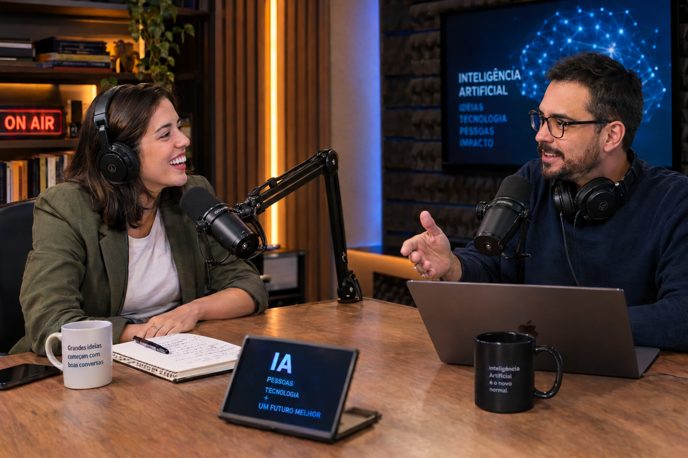

# Meu Podcast Fake Sobre os Perigos da IA

## 📒 Descrição
Fiz esse desafio pra brincar de criar com IA. Criei uma imagem e um podcast falsos, como se fosse um episódio de verdade sobre os perigos da inteligência artificial.

## 🤖 Tecnologias Utilizadas
- NotebookLM - pra gerar o podcast
- ChatGPT / DALL-E - pra gerar a imagem
- ChatGPT - pra me ajudar com os prompts
- GitHub - pra publicar tudo aqui

## 🧐 Processo de Criação
1. Escolhi as fontes e joguei tudo no NotebookLM.
2. Pedi um podcast com dois apresentadores e umas piadinhas leves.
3. Criei um prompt em inglês pra gerar a imagem bem realista do estúdio.
4. Subi a imagem, o áudio e o README aqui no GitHub.

## 🚀 Resultados
Olha como ficou a cena do estúdio:

E aqui dá pra ouvir o episódio:

[🎧 Ouvir o podcast](assets/audio/podcast-ia.m4a)

## 💭 Reflexão (Opcional)
Curti demais esse desafio, foi bem divertido. As vozes ficaram tão naturais que parece conversa de verdade, e a imagem também engana fácil. O mais engraçado é usar a própria IA pra falar dos riscos da IA.

Feito por Marcio Tarcisio | #LabDIONattyOrNot | DIO e falvojr
LinkedIn: www.linkedin.com/in/marcio-tarcisio-barros-santos-09b220161
